  

  <a href="https://play.google.com/store/apps/details?id=com.negk01.mentalmath"><picture><source media="(prefers-color-scheme: dark)" srcset="assets/profile/play-dark.svg" /></picture></a>
  <a href="https://github.com/NegK01?tab=repositories"><picture><source media="(prefers-color-scheme: dark)" srcset="assets/profile/repos-dark.svg" /></picture></a>
  <a href="https://www.linkedin.com/in/mauricio99/"><picture><source media="(prefers-color-scheme: dark)" srcset="assets/profile/linkedin-dark.svg" /></picture></a>

  <picture>
    <source media="(prefers-color-scheme: dark)" srcset="https://raw.githubusercontent.com/NegK01/negk01/output/snake.svg" />
    <source media="(prefers-color-scheme: light)" srcset="https://raw.githubusercontent.com/NegK01/negk01/output/snake-light.svg" />
    
  </picture>

